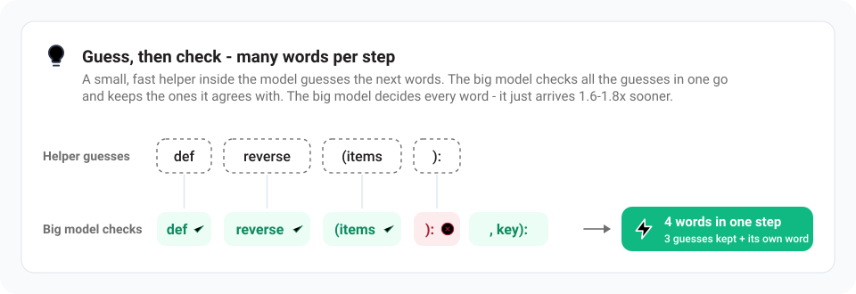

<p align="center">
  <picture>
    <source media="(prefers-color-scheme: dark)" srcset="apps/host/public/brand/strata-lockup-dark.svg">
    
  </picture>
</p>

<p align="center"><a href="README.md">English</a> · <a href="README.zh-CN.md">简体中文</a> · <a href="README.ja.md">日本語</a> · <b>Deutsch</b> · <a href="README.fr.md">Français</a> · <a href="README.es.md">Español</a> · <a href="README.pt-BR.md">Português</a></p>

<h3 align="center">Ein Spitzenmodell auf deinem eigenen Gaming-PC</h3>

<p align="center">Unterstützt NVIDIA, AMD, Intel · Windows, Linux, Mac · kostenlos und Open Source</p>

<p align="center">
  <a href="https://github.com/Niko1221/Strata/releases"></a>
  <a href="LICENSE"></a>
  <a href="https://github.com/Niko1221/Strata/stargazers"></a>
</p>

<p align="center"><a href="https://github.com/Niko1221/Strata/releases/download/v0.1.10/Pagoda.mp4"></a><br>
<sub>Ein Voxel-Pagodengarten aus einem einzigen Prompt, auf einer RTX 5070 mit Strata (IQ3_S, 128K Kontext) ·
<a href="https://github.com/Niko1221/Strata/releases/download/v0.1.10/Pagoda.mp4">ganzes Video (49 s)</a></sub></p>

Strata lässt **[Qwen3.8-Flash-Next](https://huggingface.co/Qwen/Qwen3.8-Flash-Next)** laufen, ein Modell mit 125
Milliarden Parametern, für das man sonst einen Server braucht, auf einem normalen PC. Es chattet, schreibt Code, liest
Bilder und arbeitet mit deinen Apps und Coding-Agents zusammen. Deine Chats und Dateien bleiben auf deinem PC.

**Neu hier?** Sieh dir an, [was du brauchst](#was-du-brauchst), und [installiere dann die App](#option-a-die-strata-app).

- **Läuft auf einem Gaming-PC.** 32 GB Arbeitsspeicher (RAM) und Grafikspeicher zusammen reichen für den Anfang.
- **Passt zu deinen Werkzeugen.** Strata spricht die OpenAI- und die Anthropic-API, deshalb verbinden sich Claude Code, Codex CLI, OpenCode und andere Agents damit.
- **Liest Bilder.** Das ist standardmäßig eingeschaltet.
- **Kostenlos.** MIT-Lizenz, kein Konto, keine Cloud.
- **Privat.** Keine Telemetrie. Was Strata herunterlädt, wann es das Internet nutzt und wie es Downloads prüft, steht in [docs/SAFETY.md](docs/SAFETY.md).

Version 0.2.3 · Engine 0.1.48

## Was du brauchst

**Du brauchst mindestens 32 GB Arbeitsspeicher (RAM) und Grafikspeicher (VRAM) zusammen.** Bei einem Mac oder einem Ryzen AI Max
ist das der gemeinsame Speicher. Mit mehr Speicher läuft ein größeres oder ein schnelleres Modell.

- Ein PC mit 32 GB und einer Grafikkarte mit 12-16 GB führt den Coder aus.
- Mit 64 GB RAM laufen alle Größen.

| Dein Computer | Details |
| --- | --- |
| **NVIDIA** GeForce RTX 20, 30, 40, 50 Serie (12 GB oder mehr) | Installiere die App oder das Terminal. |
| **AMD** Radeon RX 6800 und neuer, Radeon AI PRO R9700 (12 GB oder mehr) | [AMD-Karten](docs/AMD_HIP.md) |
| **Intel** Arc | [Intel Arc](docs/INTEL_ARC.md), [Intel-Engine](docs/INTEL.md) |
| **Apple-Silicon-Mac** (M1 oder neuer, macOS 15 oder neuer) | [Mac](docs/MAC.md) |
| **AMD Ryzen AI Max (Strix Halo)** und andere Systeme mit gemeinsamem Speicher | [Strix Halo](docs/STRIX_HALO.md) |
| Ältere Karten und Prozessoren | [Ältere GPUs](docs/OLDER_GPUS.md), [Ältere CPUs](docs/INSTALL.md#older-cpus-experimental) |

Außerdem nötig:

- etwa 80 GB freier Speicherplatz (mit einer SSD startet es beim ersten Mal viel schneller)
- Windows 10 / 11, Linux oder macOS
- ein aktueller Grafiktreiber

Zwei oder drei Karten desselben Herstellers können sich ein Modell teilen ([Multi-GPU](docs/MULTI_GPU.md)). Strata teilt ein
Modell nie auf NVIDIA- und AMD-Karten auf. Die vollständige Liste: [docs/INSTALL.md](docs/INSTALL.md#what-you-need).

## Installation

Such dir eine Option aus. Alle starten dieselbe Engine und nutzen dieselben Modelle.

### Option A: die Strata-App

Der einfachste Weg. Die App bringt die Engine mit: installieren, ein Modell wählen, chatten. Lade die Datei für dein
System und deine Grafikkarte von der [Releases-Seite](https://github.com/Niko1221/Strata/releases/latest) herunter. Du bist
unsicher, welche du brauchst? Lies den Absatz unter der Tabelle.

| System | Deine Grafikkarte | Datei zum Herunterladen |
| --- | --- | --- |
| **Windows 10 / 11** | NVIDIA RTX, Treiber 580 oder neuer | [`Strata-0.2.3-windows-cuda13.exe`](https://github.com/Niko1221/Strata/releases/latest/download/Strata-0.2.3-windows-cuda13.exe) |
| | NVIDIA, ältere Karte oder Treiber älter als 580 | [`Strata-0.2.3-windows-cuda12.exe`](https://github.com/Niko1221/Strata/releases/latest/download/Strata-0.2.3-windows-cuda12.exe) |
| | AMD Radeon RX 9000 Serie oder Radeon AI PRO R9700 | [`Strata-0.2.3-windows-hip.exe`](https://github.com/Niko1221/Strata/releases/latest/download/Strata-0.2.3-windows-hip.exe) |
| | AMD Radeon RX 7000 Serie oder Ryzen AI Max (Strix Halo) | [`Strata-0.2.3-windows-hip-rdna3.exe`](https://github.com/Niko1221/Strata/releases/latest/download/Strata-0.2.3-windows-hip-rdna3.exe) |
| **Linux** | NVIDIA RTX, Treiber 580 oder neuer | [`Strata-0.2.3-linux-nvidia-cuda13.AppImage`](https://github.com/Niko1221/Strata/releases/latest/download/Strata-0.2.3-linux-nvidia-cuda13.AppImage) |
| | NVIDIA, ältere Karte oder Treiber älter als 580 | [`Strata-0.2.3-linux-nvidia-cuda12.AppImage`](https://github.com/Niko1221/Strata/releases/latest/download/Strata-0.2.3-linux-nvidia-cuda12.AppImage) |
| | AMD Radeon RX 9000 Serie oder Radeon AI PRO R9700 | [`Strata-0.2.3-linux-amd-rx9070.AppImage`](https://github.com/Niko1221/Strata/releases/latest/download/Strata-0.2.3-linux-amd-rx9070.AppImage) |
| | AMD Radeon RX 7000 Serie | [`Strata-0.2.3-linux-amd-rx7900.AppImage`](https://github.com/Niko1221/Strata/releases/latest/download/Strata-0.2.3-linux-amd-rx7900.AppImage) |
| | AMD Ryzen AI Max (Strix Halo) | [`Strata-0.2.3-linux-amd-strixhalo.AppImage`](https://github.com/Niko1221/Strata/releases/latest/download/Strata-0.2.3-linux-amd-strixhalo.AppImage) |
| **Mac** (Apple Silicon, macOS 15 oder neuer) | eingebaut | [`Strata-0.2.3-mac.dmg`](https://github.com/Niko1221/Strata/releases/latest/download/Strata-0.2.3-mac.dmg) |

**Wenn du unsicher bist:** Bei NVIDIA nimmst du `cuda13`, wenn dein Treiber Version 580 oder neuer ist, sonst `cuda12`.
`cuda12` ist für ältere Karten und ältere Treiber. Die Dateien `hip` und `amd` sind für AMD-Karten. Für andere AMD-Karten
(RX 6000) gibt es noch keine fertige App: siehe [AMD-Karten](docs/AMD_HIP.md).

Danach:

- **Windows:** Starte die `.exe`. Sie wird für deinen Benutzer installiert und braucht keine Administratorrechte. Wenn
  Windows "Der Computer wurde durch Windows geschützt" meldet, wähle **Weitere Informationen** und dann **Trotzdem
  ausführen** (der Installer ist noch nicht signiert).
- **Linux:** Mach die Datei ausführbar (`chmod +x`) und starte sie. Sie braucht FUSE 2: `sudo apt install libfuse2`
  (Ubuntu 22.04) oder `libfuse2t64` (Ubuntu 24.04 und neuer).
- **Mac:** Öffne die `.dmg` und zieh Strata in den Ordner "Programme".

Auf dem ersten Bildschirm liest die App deinen PC aus und empfiehlt ein passendes Modell. Drück auf Installieren. Das Modell
ist ein großer Download (etwa 40-70 GB) und wird nach einer Unterbrechung dort fortgesetzt, wo er aufgehört hat. Wenn du
das Fenster schließt, beenden sich Strata und die Engine.

### Option B: das Terminal (eine Zeile)

Das Terminal ist der Befehl `strata`, gedacht für Skripte, Server und KI-Agents.

Linux und Mac:

```sh
curl -fsSL https://github.com/Niko1221/Strata/releases/latest/download/install.sh | sh
```

Windows (PowerShell):

```powershell
irm https://github.com/Niko1221/Strata/releases/latest/download/install.ps1 | iex
```

Das Skript prüft deinen PC, lädt das Terminal herunter, kontrolliert die SHA-256-Prüfsumme und entpackt es in deinen
Home-Ordner. Es braucht keine Administratorrechte. Öffne unter Windows danach ein neues Terminalfenster. Dann startest du
Strata:

```sh
strata launch
```

Es stellt dir eine Frage nach der anderen: Modell, Kontext, Bilder, wer sich verbinden darf. Danach lädt es die Engine für
deine Grafikkarte herunter (signiert und vor der Nutzung probeweise gestartet), dazu das Modell, und beginnt zu laufen.
Für Skripte und KI-Agents gibt es Flags:

```sh
strata launch --model q2_0 --yes --no-tui
```

Wenn du das Installationsskript vor dem Ausführen lesen willst, lade es zuerst mit `curl -fsSL <address> -o install.sh`
herunter, lies es und führe dann `sh install.sh` aus. Alle Bildschirme und Flags: [docs/TERMINAL_LAUNCH.md](docs/TERMINAL_LAUNCH.md).

### Option C: deine KI richtet es ein

Füge das in Claude Code, Cursor, Codex, GitHub Copilot oder einen anderen Coding-Assistenten ein:

```text
Set up Strata on this PC for me: https://github.com/Niko1221/Strata - follow docs/AI_SETUP.md in that repository.
```

Der Assistent prüft deine Grafikkarte, deinen Arbeitsspeicher und den Speicherplatz, wählt das passende Modell, installiert
und startet es und sagt dir, wie du deine Apps verbindest. KI-Werkzeuge können Strata auch über den
[MCP-Server](docs/MCP_SERVER.md) installieren, starten und stoppen.

Du willst es lieber selbst bauen? Siehe [Aus dem Quellcode bauen](#aus-dem-quellcode-bauen).

## Modelle

Die App und `strata launch` empfehlen ein Modell passend zu deinem Speicher. Es ist ein einziges Modell in mehreren
Größen, mehr oder weniger stark komprimiert. Kleinere Größen sind schneller. Größere Größen sind etwas klüger.

### Wenig Speicher? Probier Gyro

[Gyro](https://huggingface.co/agentionai/Qwen3.8-Flash-Next-Gyro-GGUF) (von agentionai) ist die kleinste Möglichkeit, dieses Modell auszuführen.

| Größe | Benötigter Speicher (RAM + VRAM) | Download | Was es ist |
| --- | ---: | ---: | --- |
| **Gyro-S** | 27,6 GB | 58,5 GB | Für PCs, auf denen nichts anderes läuft. Die Qualität ist geringer als bei IQ2_XS. |
| **Gyro-M** | 35 GB | 92,0 GB | Ungefähr die Qualität von IQ3_XXS bei etwa 20 % weniger GPU-Speicher. Es schreibt Antworten langsamer als Q2_0: 16 % auf einer RTX 3060 mit 12 GB, 21 % auf einer R9700. |

Gyro läuft auf NVIDIA- und AMD-Karten (bei AMD experimentell) auf Intel-Arc-Karten unter Linux (getestet auf einer Arc A750) und ab 0.2.2 auf Macs mit Apple Silicon (Gyro-S auf einem Mac mini mit 32 GB: 9 Tokens/s, die Experten werden von der SSD gelesen). Details und Messwerte:
[docs/GYRO.md](docs/GYRO.md). Starte es mit `strata launch --model gyro-s`.

### Die anderen Größen

| Dein Speicher (RAM + VRAM) | Nimm | Hinweise |
| --- | --- | --- |
| **32 GB** | **Gyro-S**, oder den **[Coder](docs/MODELS.md#coder)** für Code | Der Coder braucht 32 GB RAM und behält die Hälfte der Experten, deshalb ist er außerhalb von Code schwächer |
| **40 GB** | **[Swift 1.5](docs/MODELS.md#swift-15)** IQ2_XS (39,2 GB), oder **Gyro-M** (35 GB) | Swift denkt kürzer nach, bevor es antwortet. Gyro-M kommt der Qualität von IQ3_XXS nahe, schreibt Antworten aber 16-21 % langsamer als Q2_0 |
| **48 GB** | **IQ3_XXS** (47,0 GB) | Langsamer, besser |
| **64 GB** | **IQ3_S** (54,8 GB), das Original oder Swift 1.5 | Am langsamsten, am besten. Es erreicht in den veröffentlichten Tests das volle Modell |
| **96 GB oder mehr** | **UD-IQ4_XS** von Unsloth (etwa 72 GB RAM) bis **Q8_0** (etwa 136 GB), 4 bis 8 Bit | Näher am vollen Modell. Bei weniger RAM liest Strata einen Teil von der SSD, das ist viel langsamer |

Auch mit weniger RAM, als eine Zeile nennt, kann es funktionieren: Strata wechselt von selbst in seinen
[Modus für wenig RAM](docs/MODELS.md#a-big-graphics-card-and-little-ram). Rechne mit weniger Tempo, mit einer kleinen
Grafikkarte mit deutlich weniger.

Weitere Auswahl:

- **[Swift 1.5](docs/MODELS.md#swift-15)** ist eine Feinabstimmung, die kürzer nachdenkt, bevor sie antwortet, bei etwa gleicher Qualität und gleichem RAM-Bedarf.
- **[NVFP4](docs/NVFP4.md)** ist NVIDIAs 4-Bit-Version für NVIDIA-Karten. Sie braucht etwa 80 GB RAM, um alle Experten im RAM zu halten.
- **[Qwen3.6-35B-A3B](docs/QWEN36.md)** ist ein kleineres, anderes Modell, das Bilder liest und mehrere Anfragen gleichzeitig beantworten kann.
- **[OrcaRouters Uncensored IQ3_XXS](docs/MODELS.md#orcarouter-uncensored-iq3_xxs)** richtest du von Hand ein.

Alle Größen, Downloads und was wo läuft: [docs/MODELS.md](docs/MODELS.md).

### DeepSeek V4.1-Flash (im Terminal, ab 0.2.4)

[DeepSeek V4.1-Flash](https://huggingface.co/ISTA-DASLab/DeepSeek-V4.1-Flash-1017-GSQ-RCO-GGUF) ist ein anderes, deutlich größeres Modell. ISTA-DASLab hat die drei Sets unten gebaut. Strata startet sie auf einem PC mit einer 12-GB-Grafikkarte und 46 bis 64 GB RAM und liest den Rest von der SSD. Es läuft auf NVIDIA-RTX-Karten der Serien 30 bis 50 und auf der Radeon AI PRO R9700. Es nutzt ein eigenes Engine-Paket, `strata-dsv41`, das `strata launch` lädt, wenn du DeepSeek wählst. Die Desktop-App bietet es noch nicht an.

| Set | Download | Qualität im Vergleich zum Originalmodell | Antwortet mit |
| --- | ---: | --- | --- |
| **IQ1_M** (1,75 Bit) | 239 GB | KL 0,217, Perplexität 3,80 (+21 %); Code +8,9 %, Agent-Aufgaben +10,2 %; schwächer bei einfacher englischer Prosa. Laut Modellkarte von ISTA-DASLab behält es 98,7 % des Aufgabendurchschnitts des Basismodells (AIME25, GPQA-Diamond, LiveCodeBench v6). | noch nicht gemessen |
| **IQ2_XXS** (2.00 Bit) | 257 GB | KL 0,170, Perplexität 3,63 (+15,5 %); Code +8,6 %, Agent-Aufgaben +5,3 % | etwa 8 bis 10 Tokens/s auf einer RTX 3060 (Code 9,9, Agent-Aufgaben 7,8), etwa 5 auf einer RTX 5070 |
| **IQ2_XS** (2.25 Bit) | 274 GB | KL 0,107, Perplexität 3,37 (+7,3 %); Code +3,2 %, Agent-Aufgaben +2,2 % | etwa 11 Tokens/s auf einer Radeon AI PRO R9700 |
| **IQ4_NL** (Engram-Tabelle, kein drittes Modell) | 111 GB, schon in allen drei Downloads oben enthalten | Die 4-Bit-Engram-Nachschlagetabelle, die das Modell aus RAM oder SSD liest. Alle drei Sets nutzen diese eine Datei (`DeepSeek-V4.1-Flash-Engram-IQ4_NL.gguf`). | n/a |

4x Radeon AI PRO R9700: etwa 31 Tokens/s, 55 bis 69 mit DSpark.

Starte es mit `strata launch --model ist-das-2.00bpw` (oder `ist-das-1.75bpw`, `ist-das-2.25bpw`). Details, Geschwindigkeiten je Karte und die manuelle Installation: [docs/DEEPSEEK41.md](docs/DEEPSEEK41.md).

## Wie schnell ist es?

Gemessen mit einer Grafikkarte mit 12 GB (RTX 5070, Ryzen 5 7600, 64 GB RAM). Ergebnisse anderer Karten findest du hier:
[Tempo jeder Größe](docs/MODELS.md#how-fast-is-each-size), [Ergebnisse der Community](docs/COMMUNITY_BENCHMARKS.md).

| Modell | Antworten erscheinen mit | Liest deinen Prompt mit |
| --- | --- | --- |
| **Q2_0** | `████████████` 94 Tokens/s | `████████████` 2.650 Tokens/s |
| **IQ2_XS** | `██████████░░` 79 Tokens/s | `█████████░░░` 2.090 Tokens/s |
| **IQ3_XXS** | `████████░░░░` 62 Tokens/s | `████████░░░░` 1.750 Tokens/s |
| **IQ3_S** | `███████░░░░░` 53 Tokens/s | `███████░░░░░` 1.620 Tokens/s |
| **Coder** | `███████░░░░░` 55 Tokens/s | `██████████░░` 2.180 Tokens/s |

Ein Token ist etwa ¾ eines Wortes, 60 Tokens pro Sekunde sind also schneller, als du lesen kannst. "Liest deinen Prompt"
beschreibt, wie schnell Strata ein langes Dokument, Code oder einen Chatverlauf aufnimmt.

Gemessen mit einer AMD-Karte mit 16 GB (RX 9070 XT, Ryzen 9 3900X, 47 GB RAM):

| Modell | Antworten erscheinen mit | Liest deinen Prompt mit |
| --- | --- | --- |
| **Q2_0** | `████████░░░░` 60 Tokens/s | `█████░░░░░░░` 1.160 Tokens/s |
| **IQ2_XS** | `███████░░░░░` 52 Tokens/s | `█████░░░░░░░` 1.110 Tokens/s |
| **Coder** | `██████░░░░░░` 44 Tokens/s | `██████░░░░░░` 1.420 Tokens/s |

Die Balken haben in beiden Tabellen denselben Maßstab. Eine Karte mit mehr VRAM ist schneller. Eine RTX 3090 (24 GB) sollte
etwa 100-140 Tokens pro Sekunde schreiben. Die Engine-Version hinter jeder Zahl steht in [DETAILS.md](docs/DETAILS.md#speed-measured).

## Benutzung

### In der App

Die App hat einen **Chat**, einen **Monitor** für das Modell sowie für GPU, CPU und RAM, eine Seite **Modelle** und die
**Einstellungen**. Der Chat kann in einem Ordner auf deinem PC arbeiten. Im Modus **Manuell** fragt er nach, bevor er eine
Datei ändert oder einen Befehl ausführt. Mit `/loop 10m <what to do>` wiederholst du eine Nachricht alle 10 Minuten, solange
der Chat geöffnet ist.

Der Chat kann das Web mit DuckDuckGo (oder Bing) durchsuchen, ohne Konto. Unter **Einstellungen, Tools** kannst du einen
Suchschlüssel hinzufügen. Die Suche ist die einzige Funktion, die etwas von deinem PC sendet (die Suchbegriffe).

Um zwei Modelle auszuführen, schalte **Mehrere Modelle ausführen** ein und gib jedem Modell eine eigene Karte desselben
Herstellers.

<p align="center"><br>
<sub>Ein Chat in der Strata-App: Der Agent hat einen kleinen Voxel-Pagodengarten als eine HTML-Datei geschrieben, und die Seite öffnet sich in der Vorschau neben dem Gespräch</sub></p>

### Im Terminal

<p align="center"><br>
<sub><code>strata monitor</code>, während das Modell antwortet: Geschwindigkeit, GPU, Speicher und die letzten Anfragen</sub></p>

```sh
strata launch                                  # guided screens: model, context, pictures, access, then serve
strata launch --model q2_0 --yes --no-tui     # no questions: serve, print the address, return
strata launch --plan --model q2_0              # show what would happen; nothing changes
strata launch --status                         # what is being served now
strata launch --stop                           # stop it
strata monitor --url http://127.0.0.1:8080     # watch speed, GPU, memory and requests
strata update --check                          # is there a new engine? (strata update installs it)
strata doctor                                  # check the installed engine files
```

`strata --help` listet alles auf. Starten und Bereitstellen laden nichts herunter. Nur die Installation, `strata launch`
(wenn du ein Modell wählst) und `strata update` tun das. Um Strata von deinem Handy oder einem anderen PC aus zu erreichen,
nutze `strata launch --access lan`. Der Befehl erzeugt einen API-Schlüssel und startet in einem Netzwerk nicht ohne einen.
Ein Browser öffnet sich nur, wenn du `--open` angibst. Anleitung: [docs/TERMINAL_LAUNCH.md](docs/TERMINAL_LAUNCH.md). Der ganze Client: [docs/TERMINAL.md](docs/TERMINAL.md).

### Mit KI-Agents

Ein Agent installiert Strata mit dem Einzeiler aus Option B und führt
`strata launch --model NAME --yes --no-tui` aus. Die Schritte, Flags und Exit-Codes stehen in [docs/AI_SETUP.md](docs/AI_SETUP.md),
die Regeln für das Repository in [AGENTS.md](AGENTS.md).

### Andere Apps verbinden

| App-Typ | Basis-URL |
| --- | --- |
| OpenAI-kompatibel (die meisten Apps und Agents) | `http://127.0.0.1:8080/v1` (beliebiger API-Schlüssel, beliebiger Modellname) |
| Anthropic-API (Claude Code und andere) | `http://127.0.0.1:8080`, ohne `/v1`. Diese Apps hängen `/v1/messages` selbst an. Claude Code: `ANTHROPIC_BASE_URL=http://127.0.0.1:8080` |
| OpenAI Responses API (Codex CLI) | `http://127.0.0.1:8080/v1/responses` ([Einrichtung](docs/DETAILS.md#the-responses-api-and-codex-cli)) |

`strata connect` gibt die genauen Einstellungen für OpenCode, Codex CLI, Claude Code, oh-my-pi, pi, Hermes Agent und OpenClaw aus.
`strata connect opencode --write` schreibt die Datei nach einer Rückfrage und legt eine Sicherung an.

### Bilder

Bilder sind für Modelle, die sie lesen können, standardmäßig eingeschaltet. Hänge ein Bild im Chat an oder füge es ein, oder
sende es aus deiner App. Der Bildleser läuft auf dem Prozessor, wenn deine Grafikkarte weniger als 24 GB hat (einige Sekunden
pro Bild, ohne Speicher der Karte zu belegen), und ab 24 GB auf der Grafikkarte. Die Regel gilt für NVIDIA und AMD gleich.
Du kannst Bilder pro Modell ausschalten oder den Leser mit `--vision off`, `--vision gpu` oder `--vision cpu` wählen.

Die Zahlen hinter der Regel: Auf einer Radeon AI PRO R9700 brauchte der Bildleser der Karte 57 ms für ein Bild mit 260 Tokens,
der des Prozessors 3,1 s. Auf Karten mit 16 GB (Tesla P100 und RTX A4000, Linux) kostete der Bildleser der Karte 3-5 % des
Texttempos, weil er etwa 1,4 GB belegt, die sonst das Modell nutzen würde. Auf dem Mac liest die GPU, egal wie viel Speicher er hat (0,45 s für ein Bild mit 260 Tokens auf einem M4 mit 32 GB, etwa 1,2 GB des gemeinsamen
Speichers); der Prozessor braucht dort etwa 50 s pro Bild und liest deshalb nur mit `--vision cpu`.

### Gut zu wissen

- Das Denkniveau (**aus, niedrig, mittel oder hoch**) stellst du im Chat-Menü oder unter "reasoning effort" in deiner App ein. Aus ist am schnellsten.
- Strata beantwortet standardmäßig eine Anfrage nach der anderen. Für mehrere gleichzeitig nutze `--parallel N` in `strata launch` oder
  `"parallel": 2` in der Konfiguration ([BATCHING.md](docs/BATCHING.md)). Auf einer Karte mit 12 GB wird dadurch jede Antwort langsamer.
- Strata liest die erste Nachricht eines Chats komplett, etwa 1 Minute pro 30.000 Tokens. Folgenachrichten starten in Sekunden.
- Wo deine Chats gespeichert werden und die ganze API: [docs/INSTALL.md](docs/INSTALL.md#where-things-are-stored), [docs/DETAILS.md](docs/DETAILS.md#using-it).

## Aus dem Quellcode bauen

<details>
<summary>Windows, Linux und Mac aus dem Repository</summary>

[Lade Strata herunter](https://github.com/Niko1221/Strata/archive/refs/heads/main.zip) und entpacke es, oder nutze `git clone`.
**Windows:** Doppelklick auf `START-HERE.bat`. **Linux:** Führe `./setup.sh` im Strata-Ordner aus.

**Mac (Apple Silicon, macOS 15 oder neuer):** Installiere einmal die Command Line Tools von Apple mit `xcode-select --install`
(Xcode selbst brauchst du nicht). Öffne das Terminal im Strata-Ordner und führe `./setup.sh` aus. Das Skript baut die
Mac-Engine auf deinem Mac (etwa 7 Minuten), stellt dieselben Fragen, lädt das Modell herunter und startet es. Beim nächsten
Mal startet `./setup.sh` sofort. Welche Größe zu deinem Mac passt: [docs/MAC.md](docs/MAC.md).

Der Installer erkennt deine Karte und richtet die passende Engine ein. Er fragt, welches Modell und welche Größe du willst,
wie viel Kontext (wie viel Text sich das Modell merkt) und ob es Bilder lesen soll. Drück Enter für die empfohlene Antwort.
Dann lädt er das Modell herunter (etwa 70 GB) und startet es. Wenn der Download abbricht, führe das Skript erneut aus, dann
geht es weiter. Dein Browser öffnet die Strata-Seite unter `http://127.0.0.1:8080`.

> Während das Modell startet, kann dein PC 1-3 Minuten langsam sein oder nicht reagieren (beim ersten Mal am längsten). Strata
> lädt 35-55 GB in deinen RAM und sperrt einen Teil davon für die Grafikkarte. Warte ab und schließe das Fenster nicht.

Starte beim nächsten Mal wieder `START-HERE.bat` (oder `./setup.sh`). Es startet sofort und lädt nichts doppelt herunter.
Schließ sein Fenster, um das Modell zu beenden. `UPDATE.bat` (`./update.sh`) aktualisiert Strata, ohne es zu starten.
Aktualisieren, Docker, mehrere Karten, wohin die Dateien kommen und alle Optionen: [docs/INSTALL.md](docs/INSTALL.md).

Um deinen PC zu messen, führe `BENCH.bat` (`./bench.sh`) aus. Das dauert 5-10 Minuten und schreibt einen Bericht, den du teilen
kannst ([so geht's](docs/COMMUNITY_BENCHMARKS.md#run-the-benchmark)).

**Optional: mehr Tempo auf einer Karte, wenn das ganze Modell in den RAM passt.** Zwei Einstellungen zum Einschalten von
RubenTorney (#1904, #1905). Sie helfen, wenn du eine Grafikkarte nutzt und dein RAM alle Experten aufnimmt, zum Beispiel bei
Q2_0 oder IQ3_XXS auf einem PC mit 64 GB. Öffne `strata-<model>.json` im Strata-Datenordner ([wo](docs/INSTALL.md#where-things-are-stored)) und ergänze:

- `"--adapt-async", "1"` in der Liste `"args"`. Der Expertencache wird dann in einem Hilfsthread aktualisiert, statt die
  Antwort anzuhalten. Gemessen auf einer RTX 5070 (Windows, Q2_0): +4-5 % beim Decodieren, +7-10 % bei Code und langen
  Dokumenten. Die Antworten können sich leicht von der Standardeinstellung unterscheiden und bleiben von Lauf zu Lauf gleich.
- `"STRATA_PIN_BY_NEED": "1"` im Block `"env"` (Windows). Windows kann nur etwa die Hälfte des RAM für die Grafikkarte sperren,
  und diese Einstellung sperrt zuerst die Experten, die die Karte am dringendsten braucht. Gemessen auf der RTX 5070: +4,4 % beim Lesen des Prompts.

```json
"args": [ ..., "--adapt-async", "1" ],
"env": { "STRATA_PIN_BY_NEED": "1" }
```

Starte Strata nach der Änderung neu. Zum Rückgängigmachen entfernst du die beiden Einträge.

</details>

## Wie funktioniert das?

Modelle wie dieses laufen normalerweise auf Servern mit Hunderten Gigabyte Grafikspeicher. Deine Grafikkarte hat 12-24 GB.
Strata bringt das Modell auf deinen PC, indem es die Arbeit auf den ganzen Rechner verteilt. Stell dir eine Bibliothek vor.

- Das Modell ist ein Team aus 24.576 kleinen Spezialisten ("Experten"), wie 24.576 Nachschlagewerke. Für jedes Wort braucht es nur 10 davon.
- **Deine Grafikkarte ist der Schreibtisch.** Er ist klein und schnell. Die etwa 4.000 am häufigsten genutzten Bücher liegen
  dort aufgeschlagen.
- **Dein RAM sind die Regale im Lesesaal.** Alle 24.576 Bücher stehen dort. Braucht ein Wort ein Buch, das nicht auf dem
  Schreibtisch liegt, holt dein Prozessor es sofort aus dem Regal, während die Karte weiterarbeitet.
- **Deine SSD ist das Archiv.** Sie enthält eine Nachschlagetabelle von 29 GB. Das Modell liest pro Wort nur wenige Zeilen
  daraus, deshalb muss sie nicht im RAM liegen.

<p align="center"></p>

Ein kleiner Helfer rät außerdem die nächsten Wörter. Das große Modell prüft sie alle auf einmal und behält die richtigen. Du
bekommst dieselbe Antwort, 1,6-1,8-mal früher. Lange Texte werden in großen Stücken gelesen, bis zu 8.192 Tokens auf einmal,
mit über 1.000 Tokens pro Sekunde.

<p align="center"></p>

Die ausführliche Erklärung: [docs/HOW_IT_WORKS.md](docs/HOW_IT_WORKS.md). Jeder Teil mit seinen Zahlen:
[die Details](docs/DETAILS.md#how-it-works) und das [Paper](docs/paper/Strata-Paper.pdf).

## Etwas ist schiefgegangen?

- **Mein PC ist beim ersten Start von Strata eingefroren.** Strata lädt das Modell in den RAM. Warte ab und schließe das
  Fenster nicht. Nach 10 Minuten immer noch eingefroren? Starte den PC neu, schließe andere Programme und versuch es noch
  einmal, oder wähle eine kleinere Größe.
- **Es ist beim Herunterladen oder Installieren stehen geblieben.** Starte die App oder `strata launch` noch einmal, oder
  führe `START-HERE.bat` (oder `./setup.sh`) erneut aus. Es macht dort weiter, wo es aufgehört hat.
- **Es ist sehr langsam, die Festplattenanzeige blinkt ständig, oder es meldet "the engine stopped unexpectedly".** Dein PC
  hat nicht genug freien RAM. Schließe andere Programme (Browser brauchen viel) oder wähle eine kleinere Größe wie Q2_0 oder IQ2_XS.
- **Es meldet, dass es keine Engine für diesen PC gibt.** Öffne in der App **Einstellungen, Engine** und drücke **Engine
  aktualisieren**. Führe im Terminal `strata update` aus. `strata doctor` zeigt, welche Engine-Dateien installiert sind.
- **Es meldet, dass Port 8080 schon belegt ist.** Strata läuft bereits. Such das Fenster.

Weitere Probleme und Lösungen: [docs/TROUBLESHOOTING.md](docs/TROUBLESHOOTING.md). Du kommst nicht weiter? Öffne ein
[Issue](https://github.com/Niko1221/Strata/issues). Hänge in der App die Datei aus **Einstellungen, Engine, Diagnose, Protokolle anzeigen, Protokolle speichern** an. Füge im Terminal die Ausgabe von `strata doctor` ein. Hänge beim Start aus dem Quellcode die
Datei `strata-<model>.log` aus dem Strata-Ordner an. Ein Sicherheitsproblem meldest du bitte privat: [SECURITY.md](SECURITY.md).

## Danksagung und Lizenz

Das Modell ist [Qwen3.8-Flash-Next](https://huggingface.co/Qwen/Qwen3.8-Flash-Next) vom Qwen-Team. Komprimiert wurde es von
[ISTA-DASLab](https://huggingface.co/ISTA-DASLab/Qwen3.8-Flash-Next-GSQ-RCO-GGUF), UkisAI (Swift 1.5), agentionai (Gyro)
und Unsloth. Strata nutzt Teile von [llama.cpp / ggml](https://github.com/ggml-org/llama.cpp). Alle Danksagungen:
[docs/HOW_IT_WORKS.md](docs/HOW_IT_WORKS.md#credits). Strata ist Open Source unter der [MIT-Lizenz](LICENSE). Einige Teile und
alle Modelle haben eigene Lizenzen ([welche](docs/HOW_IT_WORKS.md#license)).

## Mitmachen

Du hast einen Fehler gefunden oder willst eine Änderung oder einen Benchmark einsenden? Lies zuerst [CONTRIBUTING.md](CONTRIBUTING.md).
Dort steht, was dazugehört, damit andere deine Arbeit nachprüfen können.

## Strata unterstützen

Strata ist kostenlos und steht unter der MIT-Lizenz. Ich baue es und teste es auf jeder Hardware, die ich bekommen kann. Wenn es auf deinem PC gut läuft, hilft mir ein Kaffee,
weiter neue Karten zu testen und das zu beheben, was ihr meldet. Es besteht kein Druck. Strata zu nutzen und zu melden, was dir auffällt, hilft genauso viel.

<a href="https://buymeacoffee.com/strataengine"></a>

Du möchtest Strata sponsern? Schreib mir über [GitHub](https://github.com/Niko1221).
